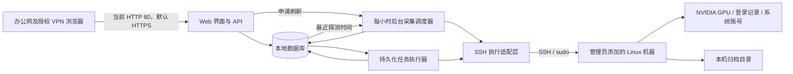

# 局域网算力机账号管理服务架构

状态：当前实现与边界说明。支持独立 Web/worker、可选 HTTP/HTTPS 和通过 SSH 管理动态录入的机器；具体发行版、认证策略及账号完整生命周期需在部署者自己的目标环境验收。

项目导航见 [README](README.md)，协作与开发规则见[开发约束](docs/TODO.md#开发约束)，实施进度见 [Todo](docs/TODO.md)。下文保留目标设计；当前代码映射和未覆盖范围见第 14 节。

## 1. 已确认的需求

| 项目 | 约定 |
| --- | --- |
| 使用环境 | Linux 算力机，目前使用 NVIDIA 显卡；具体发行版在接入时检测 |
| 初始机器 | 0 台，由管理员逐台添加；本机也必须显式添加 |
| 数量限制 | 不设机器数量上限；实际采集能力受控制主机与网络影响 |
| 访问入口 | 浏览器访问 IP 和端口，默认申请者姓名页面，姓名窗口右上角按钮切换管理员模式 |
| 管理员身份 | 控制台维护一个管理员账号和密码 |
| 机器凭据 | 每台机器分别保存已有 SSH 管理账号、SSH 密码和 sudo 密码 |
| 申请者身份 | 管理员预先维护姓名名单，申请者只输入姓名进入，不需要管理密码 |
| 开通流程 | 姓名入名单即代表审核通过，提交用户名和密码后立即执行创建 |
| 个人额度 | 默认每人跨所有机器共 3 个有效账号，管理员可调整默认额度或个人额度 |
| 机器准入 | 管理员决定各台机器是否开放申请 |
| 监控 | 展示最近 30 天登录用户数、当前 GPU/显存占用及用户进程等详情 |
| 历史账号 | 默认无登记、只读；管理员可显式接管、关联姓名和重新分配，不自动干扰工作 |
| 采集方式 | 仅控制主机通过 SSH 操作；算力机不安装 Agent 或常驻管理服务 |
| 采集时机 | 后台每小时采集所有已添加机器，不依赖网页打开；允许申请刷新 |
| 账号回收 | 管理员可回收登记账号；申请者可回收自己名下账号 |
| 归档范围 | 整个用户主目录；归档成功并校验后才删除账号 |
| 归档保留 | 永久保留，后台记录，由管理员决定何时删除归档 |
| 归档失败 | 保留账号及原数据，管理员决定后续动作 |
| 部署 | 控制主机、目标机器和运行目录由部署者自行配置 |
| 文档 | 两种模式提供完整操作指南弹窗；私密管理员记录另存，可含密码 |
| 运维 | 管理员联系人名单；公告/置顶登录弹窗；权限申请及 sudo 开关；系统工具检测；确认后整机重启 |

## 2. 设计默认值与边界

以下是可修改的设计默认值，不把它们视为用户已经确认的环境参数：

- 归档落在账号所在算力机的独立目录，默认 `/var/lib/compute-control/archives`；控制主机只保存索引。用户主目录可能很大，因此不默认经网络复制到控制主机。
- 同一人在同一台机器可拥有多个账号，只受跨机器个人总额度限制，默认 3 个。卡片及申请选项提示该人在该机已有多少账号，不因该数量禁用申请。
- 新申请默认普通 Linux 账号；可提交事由申请管理权限，由管理员协助安装、授予 sudo 或拒绝。管理员可独立切换已登记普通账号 sudo 权限；不提供 GPU 独占或配额。
- 正式入口默认要求 HTTPS；仅在用户明确选择 HTTP 时，通过 `allow_insecure_http = true` 启用生产 HTTP 和可用的非 Secure Cookie。当前用户已选择 HTTP 80，办公网及授权 VPN 限制继续保留；开发默认仅监听回环地址。
- GPU/主机快照及登录统计默认每小时后台探测，持久化最近 24 小时真实指标；当前状态只显示数值，机器卡片下拉展开历史图，允许多台同时展开。界面默认白天模式，可切换夜间并在本浏览器保存选择。
- 仅支持本地独立 Linux 用户的自动创建与回收。LDAP/NIS、共享 UID、共享主目录、跨机器共享 home 等情况必须先检查，不能按普通独立账号处理。
- 姓名是内部信任模式下的身份声明，不能证明真人身份：知道他人姓名的人能进入该身份并操作其登记账号。按已确认需求不增加邀请码或申请者密码；审计记录的是所声明姓名。
- 姓名匹配忽略英文字母大小写（含中英文混合名），保留登记写法；不在未登录入口公开整份名单。新增/改名/恢复使用同一规则；旧数据若仅大小写不同则拒绝歧义登录，由管理员区分姓名，不自动合并账号。同名人员由管理员使用不同的显示名称区分，例如“张三-研发”。改名保留内部人员 ID 和历史归属。

## 3. 总体结构与选型

采用单体 Web 应用，API 与后台任务分进程运行、共享本地数据库。初期不引入消息中间件或分布式调度。



| 层 | 建议方案 | 用途 |
| --- | --- | --- |
| 界面 | 服务端页面模板 + 少量浏览器 JavaScript | 两种模式、表格、当前状态、历史展开、任务进度；保持单一部署包 |
| API | Python + FastAPI | 会话、权限、输入校验、业务接口 |
| SSH | Paramiko | SSH 密码认证、主机密钥校验、命令通道和文件传输 |
| 数据库 | SQLite，本地磁盘，事务及唯一约束 | 人员、机器、凭据密文、账号、任务、归档索引、审计 |
| 后台 | 独立 worker，数据库任务表与采样时间 | 周期采集、账号操作、故障核对；可重启恢复 |
| 部署 | 控制主机上的 systemd 服务及 TLS 入口 | 开机启动、重启、日志、局域网访问 |

选型是本项目建议：FastAPI 文档中的响应后后台任务不能替代本项目需要的持久化任务状态；采用单独 worker 和任务表。[FastAPI 官方说明](https://fastapi.tiangolo.com/tutorial/background-tasks/)

Paramiko 提供 SSH 客户端、认证与主机密钥策略，适合统一封装远端执行。[Paramiko 官方文档](https://docs.paramiko.org/en/stable/api/client.html)

SQLite 适合初期单控制主机部署；若使用 WAL，数据库必须位于本地文件系统，写事务保持短小。后续出现持续写入竞争或需要多控制节点时迁移 PostgreSQL，机器数量本身不设置产品上限。[SQLite WAL 文档](https://sqlite.org/wal.html)

本机接入也走 SSH 适配层，必须检查本机 SSH 可用性，不提供绕过校验的本地 root 快捷路径。

## 4. 页面与权限

导航按当前状态、账号台账、权限申请、后台任务排列，再列姓名额度、公告、联系名单及归档/审计等管理入口（按角色显示）。各页均可手动更新显示；联系文本与名单集中管理，卡片查看操作在前、机器管理在后，重启置于管理组末尾。

| 页面/能力 | 管理员 | 申请者 |
| --- | --- | --- |
| 机器列表与详情 | 所有机器及全部监控字段 | 开放申请机器，以及本人已有账号的机器 |
| 名单与个人额度 | 添加、改名、停用、删除、调整额度 | 查看本人额度、已用与剩余数量 |
| 添加机器与凭据更新 | 可以 | 不可以 |
| 开放/关闭机器申请 | 可以 | 不可以 |
| 创建账号 | 可为指定名单人员发起，遵守或先调整其额度 | 为本人立即申请 |
| 姓名—机器—账号台账 | 查看全部、筛选状态、查看历史 | 仅本人 |
| 无登记账号 | 查看、显式接管并关联归属，不自动接管 | 可在监控中看到系统用户名及无登记标记 |
| 回收账号 | 登记账号，受保护账号除外 | 本人登记账号 |
| 归档 | 查看全部记录、处理失败、删除归档 | 查看本人回收状态，不删除归档、不浏览归档内容 |
| 凭据与审计 | 更新机器凭据；管理普通账号密码，人员停用/移出后显式查看留存密码；脱敏审计 | 不可访问 |
| 整机重启 | 二次确认；活动任务或状态未知时第三次确认可立即重启 | 不可以 |
| 公告与管理员名单 | 发布/删除/置顶公告，维护联系人 | 查看全部未删除历史公告；仅置顶公告登录后弹窗；查看联系人 |
| sudo 管理权限 | 处理事由申请；查看账号权限及开关 | 为本人有效账号申请，查看处理回复 |
| 操作指南与开发工具说明 | 完整管理员指南、工具分层与检测 | 完整用户指南、工具说明 |

机器关闭申请只阻止新建，不锁定或删除已有账号；已有账号的申请者仍可查看该机器及回收自己的账号。名单停用或删除使该姓名不能再进入或申请，并撤销会话；删除仅软删除姓名，保留账号与历史，不自动修改远端账号。重新添加同一姓名恢复原人员 ID。联系人名单包括姓名及联系方式，通过申请者顶栏“申请管理权限”右侧的“联系管理员”按钮弹窗显示；不创建新控制台登录账号。旧联系方式文本仍保留显示，避免升级丢失记录。

申请者在机器概览顶部可直接“申请账号”，可申请机器卡片也提供按钮并预选目标机器；已有账号或额度已满时说明原因，保留账号台账中的入口。

权限在 API 服务端校验。申请者操作使用会话中的人员 ID，不能信任客户端提交的人员 ID。管理员监控能力覆盖申请者可见的全部信息。

## 5. 机器添加与凭据

添加表单包含：显示名称、IP、SSH 端口（默认 22）、管理员用户名、SSH 密码、sudo 密码、归档根目录、是否开放申请。SSH 与 sudo 密码独立存储，可勾选相同后填入，但不能假设始终相同。

接入流程：

1. 校验 IP、端口和重复目标；后台自动获取首次 SSH 主机密钥，不要求管理员手动比对。使用同一指纹完成后续连接验证，验证成功才保存机器。
2. 验证 SSH 和 sudo 权限，检测发行版、账号工具、归档工具、NVIDIA 工具、主目录布局和登录日志来源。
3. 检查机器身份，提示重复接入；同一机器更换 IP 时更新原记录，避免生成两份管理状态。
4. 只读导入系统用户和当前监控；录入的 SSH 管理账号默认显示“已登记 · 机器管理员”，不创建申请者账号或占额度；其他已有用户不因接入被修改。
5. 保存机器和能力报告。未满足创建条件时只能用于查看，不允许开放申请。

在可信网络接入模型下，首次接入自动信任所观察的密钥；保存后继续校验，变化时停止连接，不通过更新凭据自动覆盖已保存指纹。[OpenSSH 文档](https://man.openbsd.org/ssh_config.5)

控制台密码使用专用密码哈希保存；机器密码因需要远端登录，使用认证加密保存，主密钥与数据库分离、限服务账号读取。界面只允许覆盖更新，不回显已有密码。为支持内部离职交接，新账号密码加密留存到账号台账，不返回申请者；只有姓名已停用或移出时管理员可显式查看，每次查看有审计。历史从未保存的密码无法从 Linux 哈希还原，管理员可记录已知密码或发起重设；重设候选密文与生效密码分开保存，核对成功后更新。列表及任务 API 均不暴露密文或明文，日志不记录密码。

创建密码经受限 Unix socket 短暂交给 worker 内存；即使台账留存密文，也不据此盲目重放创建，内存丢失时仍进入“等待重新输入密码”。管理员重设任务只持久化加密候选，重启后先核对远端证据。主密钥与数据库共同决定秘密可恢复性，须分开保护。

SSH 执行只提供固定操作，不暴露通用终端接口。用户名、IP、路径等分别校验；结构化输入通过通道传入，禁止将密码拼进命令、命令参数、环境变量或脚本日志。sudo 认证与业务输入使用清晰隔离的协议，兼容性探测不通过时提示处理，不盲目重试密码。

## 6. 后台监控与登录统计

### 6.1 采集与显示

- worker 对所有已添加机器默认每 3600 秒探测，网页关闭、退出或隐藏不改变采集；同机多人查看不增加采样。
- 最近尝试时间和最近成功时间分开：失败保留最后成功快照、记录错误及失败点，按小时退避，不因旧成功时间过期而每秒重试。
- 前端移除定时刷新、心跳和可见性触发；页面仅在登录、切换页面、操作或点击“更新显示”时读缓存，不自动连接远端。
- 当前状态提供“申请刷新”，后台按同机5 秒内及排队中的重复请求合并受理，不报频繁操作，不受小时采样间隔阻挡；采集完后手动“更新显示”。无常驻浏览器轮询。
- 每次真实成功采样持久化 CPU/内存/GPU/显存的紧凑指标，失败记录空指标与错误；滚动保留 24 小时。升级仅保留已有真实快照一个点，不补造历史。
- 机器卡片桌面三等分，与顶部三个统计气泡等宽、同为 18px 间距，平板/手机自适应两列/一列；统一弹窗固定顶部关闭栏、仅正文滚动，每次打开从顶部显示。每台卡片的原生下拉“最近 24 小时历史折线图”展开才读取图表；可同时展开多台对比，收起隐藏，卡片其他区域没有折线。历史不因刷新网页丢失。
- 有效点连线并显示圆点，未知值和失败留空，超过 2.5 个小时的间隔断线。CPU 在单次探测内读两次计数得到短时使用率，不以相隔一小时的平均值冒充当前值。
- 默认常规 SSH 并发 4、同机普通变更串行，采集不叠加；强制重启维持独立执行槽。所有账号、归档任务与页面状态无关。
- 保留旧 viewer-lease API 为无采集效果的兼容响应，旧表只供迁移兼容；不保留未被使用的租约配置项。

### 6.2 当前状态

机器级：连通性、最后采集时间、CPU 负载、内存、主目录及归档分区容量、当前登录用户、登记/无登记账号数量。

GPU 级：索引及 UUID、型号、驱动版本、总/已用/可用显存、GPU 利用率、显存利用率、温度、功耗（设备支持时）。进程级：GPU、PID、系统用户名、登记姓名（有映射时）、进程名、占用显存；默认不展示完整命令行，避免其中的令牌泄露。

通过 `nvidia-smi` 结构化查询 GPU 和计算进程，结合系统进程信息识别 UID/用户名；图形进程及每进程利用率仅在设备和工具支持时补充。设备不支持、MIG 限制或进程已退出等情况显示“不支持/未知”，不伪造为零。GPU 整卡利用率不能直接等同于某用户的利用率。[NVIDIA 官方文档](https://docs.nvidia.com/deploy/nvidia-smi/index.html)

掉线保留最后成功快照并明确“数据已过期”，不可把旧数据显示为实时或空闲。监控不运行基准测试，不重置 GPU，不终止进程。

### 6.3 最近 30 天活跃用户

公开账号列表、进程明细、台账及归档/权限申请展示过滤 root，后台仍保留保护和原始证据。按每台机器、滚动 30 天内成功登录过的不同系统用户名计数，不按姓名合并；同一用户名多次登录只计一次。排除 reboot/shutdown 等系统事件及失败登录，纳入有实际登录记录的历史普通账号；排除该机器录入的 SSH 管理用户名及 root。卡片突出显示人数供申请者选择，不能据此推断无人工作。

首选读取机器现有 `wtmp` 及保留的轮转记录；必要时使用该发行版可用的等价来源。`last` 依赖登录记录文件，文件缺失或轮转清理会限制可查询历史。[util-linux 的 last 文档](https://man7.org/linux/man-pages/man1/last.1@@util-linux.html)

接入时及后续小时采集时补读，持久化去重后的登录事件及来源覆盖信息，时间统一 UTC 存储、按界面时区展示。无人访问时也随后台探测补读，历史缺口只按实际日志覆盖判断。

页面同时显示统计窗口、已观察人数和完整性状态。仅看到某条最早记录不能证明完整覆盖 30 天；无法确认连续日志覆盖时标为“记录可能不完整”，无来源时显示“无法统计”。不能保证恢复接入前或无人查看期间已丢失的日志。

## 7. 申请创建与数量额度

1. 姓名登录后查看个人额度和开放机器，输入合法 Linux 用户名及密码。普通机器账号密码至少 3 个字符，不要求字符组合；最大 256 字符且排除命令输入协议不能安全表示的换行、NUL、冒号。
2. API 在事务中检查名单有效、机器开放、额度和重复申请，并预占一个名额；默认每人总额度 3 个。
3. `creating`、`waiting_password`、`active`、回收中、归档失败以及远端结果待核对的账号均占用名额。只有确认未创建或确认远端账号已删除，才释放名额。
4. 使用人员额度锁/事务和幂等键处理双击、重试及多标签页并发，不能靠前端计数防止超额。
5. worker 经 SSH 再次核对机器身份、开放状态、用户名与 home 是否已存在、系统账号来源和受保护名单。名称存在时拒绝，不修改已有密码或冒认历史账号。申请事务先按最新系统用户名清单及台账拒绝已知重名，不创建任务或占用额度；执行前再按远端实际用户复查。同名判断以目标机器为范围。
6. 创建独立 UID/GID、主目录与普通登录环境，设置密码、记录账号 ID/任务 ID 对应的创建证据；不添加高权限组。新账号登录能力需符合目标主机现有 SSH/PAM 策略。
7. 核验结果后记录人员 ID、机器 ID、用户名、UID/GID、home、创建时间和状态，向申请者提供 SSH 地址与端口，不回显密码。
8. SSH 在执行后断开时进入核对状态，重连检查创建证据和远端结果；不能仅凭“同名用户存在”认定是本任务创建，更不能自动删除不明账号。

用户名建议首版采用小写字母开头、后接小写字母/数字/下划线/连字符，总长 1–32；禁用保留用户名。具体规则需兼容目标发行版，冲突时明确报错。

额度不足提示“已达到账号上限，请联系管理员”。管理员可以修改全局默认值或个人覆盖值；降低额度不删除已有账号，仅限制继续申请。管理员代申请也应先调整额度，不隐式绕过。

登记账号生命周期：

```text
creating → active → recycle_requested → checking → quiescing
         ↘ needs_reconcile / waiting_password        ↓
                                               archiving → verifying
                                                   ↓           ↓
                                            archive_failed   deleting
                                                               ↓
                                                        retired / delete_failed
```

机器在申请后关闭开放状态不影响已有账号；尚未开始创建的任务应取消并释放预占名额。执行中关闭时需核对实际结果，不能为实现关闭申请而删除已创建账号。

## 8. 回收、完整归档与删除

### 8.1 保护范围

系统创建或经管理员显式接管、已有远端身份凭据的普通账号可走回收流程。未接管的历史账号、root、系统服务账号、机器管理账号、控制服务账号及管理员指定保护账号不得自动删除。显式接管重新核对本地 UID/home，只建立关联和管理凭据，不修改密码或终止进程；重新分配只改台账归属与额度，不改变 Linux 密码。

每次执行重查机器、用户名、UID、home 和创建证据是否匹配。UID 不符、主目录异常、共享 home、挂载点、符号链接主目录或存在来源不明文件时暂停；不得以姓名或前端路径直接决定删除对象。新建账号避免复用本系统回收过的 UID，外部管理员导致 UID 复用时报警并拒绝自动回收。

### 8.2 操作流程

1. 发起人看到机器、用户名、home、活动会话和进程，并明确确认回收。申请者只可操作会话对应的本人账号。
2. 默认遇到任何活动会话或进程就阻止回收，提示先结束工作；不自动杀掉正在工作的任务。若管理员确需强制回收，另行展示目标账号进程并二次确认终止，仅作用于该 UID。
3. 检查归档路径与 home 不重叠、磁盘空间和 inode 余量足够，检查主目录内挂载点及外部写入者。扫描无法确认时停止，不能静默跳过内容。
4. 保存原账号状态、任务调度配置等恢复信息，然后禁止目标账号新登录，停用它的 cron/at、用户服务与 lingering 等可能再次启动任务的入口。只锁密码不足以阻止所有登录方式，必须结合账号过期及实际 SSH/PAM 策略验证；不为单个账号重启或全局修改 sshd。[usermod 文档](https://man7.org/linux/man-pages/man8/usermod.8.html)
5. 再次检查目标 UID 进程及写入者。管理员确认过的终止先请求正常退出、超时后按确认范围处理；无法确保静止则暂停。`loginctl terminate-user` 可结束受其管理的用户会话，但仍需检查脱离会话的进程。[systemd 文档](https://www.freedesktop.org/software/systemd/man/latest/loginctl.html)
6. 整个 home 写入唯一任务目录中的临时归档，包含隐藏文件、SSH 配置、环境、源代码和主目录内数据；保留权限、数值 UID/GID、时间、ACL、扩展属性及硬链接关系。符号链接保存链接本身，不追踪到 home 外；外部数据不因链接而归档或删除。主目录内嵌套挂载必须先由管理员明确处理，不能悄悄漏掉。
7. 归档清单记录全部条目、类型、大小、属性和常规文件内容校验值。归档完成后读取归档进行完整性检查、与静止源目录核对，并保存归档 SHA-256。不能仅凭压缩命令退出码或归档存在就判成功。若目录仍变化、权限丢失或遇到不能保存的对象，标记失败。
8. 校验成功后原子发布正式归档和 manifest，落库验证结果。重新检查目标状态和归档有效性，再执行账号删除；禁止强制跳过系统检查。[userdel 文档](https://man7.org/linux/man-pages/man8/userdel.8@@shadow-utils.html)
9. 账号删除与原 home 清理分开记录：先删除系统账号，再只清理已核对的原 home。不直接使用广泛通配路径；删除 home 前重新校验路径/挂载状态，避免变更竞态。非 home 文件不自动扫描删除。
10. 远端账号确认消失后释放额度；原目录未清理则显示“账号已删除，原目录待清理”，记录独立失败任务。归档及账号映射保留历史。完成原 home 清理且没有执行中任务后，可按当前身份清理台账显示；可勾选已清理记录并恢复，不删除历史。

归档失败时保留原账号和主目录；若已经禁用登录，则保持“归档失败、账号已停用”并提示管理员。管理员可重试归档、取消回收并恢复保存的状态，或人工处理；系统不在失败后自动删除、自动恢复任务或自动释放额度。

归档成功但删除失败时保留归档和账号，重试前核对；如果恢复使用或源数据发生变化，旧归档不能用于后续回收，必须产生新归档版本。

### 8.3 归档组织与保留

```text
<archive_root>/<machine_id>/<account_id>/<job_id>/
  home.tar                 # 可按机器能力配置压缩；默认避免高 CPU 压缩干扰计算
  manifest.json            # 来源、UID、home、条目、校验信息、版本
  checksum.sha256
  retirement-metadata.json # 原账号及调度恢复信息，敏感内容限管理员读取
```

根目录与元数据仅管理员/root 可读，任务临时文件权限受限；不能放在申请者可写路径内。归档目录默认永久保留，不设按年龄清理规则。永久保留是保留策略，不代表磁盘故障下有备份；归档目录的容量与备份状态在管理员页面展示。

只有管理员可删除归档，需确认账号、路径和不可恢复后果；禁止删除仍被未完成回收任务依赖的归档。删除文件成功后保留墓碑记录、操作人、时间和审计，不删除历史归属。机器离线时标记待执行，不能先声称归档已删除。

## 9. 数据模型与任务一致性

| 表 | 核心字段 |
| --- | --- |
| admin | 单一管理账号、密码哈希、联系方式文本 |
| applicants | 内部 ID、唯一显示姓名、是否启用、个人额度覆盖值、软删除时间 |
| settings | 默认额度 3；启动采集/并发/会话参数见配置文件 |
| machines | ID、地址、SSH 端口、主机身份/指纹、凭据密文、归档路径、开放状态、能力报告 |
| machine_users | 观察到的用户名/UID/home、登记关联、首次与最近观察时间、是否受保护 |
| accounts | 人员/机器 ID、用户名、UID/GID/home、创建/接管证据、生命周期、额度、密码密文与来源 |
| login_events | 机器、用户名、登录时间、来源标识、去重键 |
| coverage | 日志来源与读取范围、缺失区间、完整性可信度 |
| snapshots | 每机最新主机/GPU/进程快照、采集时间与错误 |
| viewer_leases | 仅兼容旧表，已不参与后台调度 |
| machine_samples | 机器、真实采样时间、紧凑指标及失败状态，滚动 24 小时 |
| announcements / admin_contacts | 公告正文、置顶、软删除；独立联系姓名和联系方式 |
| permission_requests | 原申请人、账号、事由、处理选择、回复和授权任务关联 |
| account_ledger_dismissals / machine_notes | 每个查看身份独立清理标记；机器共享备注与作者/时间，不改原账号 |
| jobs | 类型、对象、幂等键、步骤、状态、重试次数、租约、最近错误、远端执行证据 |
| archives | 账号、机器、路径、大小、摘要、校验状态、创建/删除时间 |
| audit_logs | 所声明身份/管理员、来源 IP、动作、目标、结果、时间；脱敏 |

账号持久保存 `last_active`，按机器与用户名从成功登录事件单调更新；原始明细过期不清除此时间。升级时从已有明细回填，API 同时读取现有可观测记录补充，未知保持 null，申请者仍只看本人账号。

数据库保留同一机器用户名台账唯一，允许同人同机多账号；额度检查和预占名额在同一短事务内完成。旧版 person_machine 唯一索引在升级时移除，保留普通查询索引。网络操作不放在数据库事务里。

worker 使用持久化步骤和任务租约，同一对象不能同时创建/回收。进程重启后先核对远端实际状态，再决定继续；远端长操作使用任务 ID 和受限进度文件记录结果，不安装常驻服务。SSH 断线并不代表远端命令停止，发现远端仍运行时不能启动重复归档。

只读采集可有限退避重试；账号创建/删除不能因超时盲目重复。失败必须显示可理解的阶段与下一步，不把“部分成功”标为全部成功。

账号、归档和审计记录长期保留；登录明细默认保留 90 天供滚动统计；后端保留最新完整快照和最近 24 小时紧凑历史指标；浏览器展开机器下拉时读取并显示真实点，不补造缺失点。机器停用/移除采用软删除，有账号、归档或任务时必须保留关联与恢复连接方式。

## 10. API 与模块边界

| 接口组 | 主要职责 |
| --- | --- |
| `/api/auth/*` | 管理员登录、姓名登录、退出、当前身份 |
| `/api/admin/applicants/*` | 名单、默认/个人额度管理 |
| `/api/admin/machines/*` | 添加、测试、首次密钥自动记录、凭据更新、开放申请、重启预检查/提交/核查 |
| `/api/admin/accounts/*` | 显式接管、重新分配、记录/重设密码、受限查看留存密码 |
| `/api/admin/settings/*` | 默认额度及管理员联系方式 |
| `/api/guides`、`/api/operation-guide` | 共享开发工具说明、按登录角色返回公开操作指南 |
| `/api/machines/*` | 当前身份可见机器、快照、活动统计、合并刷新 |
| `/api/viewer-lease` | 旧客户端兼容响应，不控制采集 |
| `/api/machines/{id}/history` | 按机器可见范围读取 24 小时真实指标 |
| `/api/announcements`、`/api/admin/announcements/*` | 成员读公告；管理员发布、置顶及软删除 |
| `/api/admin-contacts`、`/api/admin/contacts/*` | 成员读联系名单；管理员增改删联系人 |
| `/api/permission-requests`、`/api/admin/permission-requests/*` | 本人提交及查看事由申请；管理员回复和选择处理 |
| `/api/accounts/{id}/ledger/*` | 管理员或账号本人清理/恢复自身台账显示，确认已回收且无未完成任务 |
| `/api/machines/{id}/notes` | 可见机器的成员读取与追加共享备注，保存作者及时间 |
| `/api/admin/password` | 当前管理员验证旧密码后修改 Web 密码，撤销全部管理员会话 |
| `/api/admin/machines/{id}/password`、`/password/check` | 当前管理员再次认证，实际修改连接账号密码并核查新 SSH/sudo 凭据，禁止盲目重放 |
| `/api/admin/accounts/{id}/privilege` | 管理员排队切换 sudo 权限并审计，远端验证结果 |
| `/api/accounts/*` | 申请、查看本人/管理员台账、回收预检查与提交 |
| `/api/jobs/*` | 任务阶段、失败原因、重新输入密码；敏感修复仅管理员 |
| `/api/admin/archives/*` | 归档记录、核验、删除预检查与提交 |
| `/api/admin/audit/*` | 审计与故障记录 |

任何变更都使用明确的写接口，不能用 GET 删除。会话使用 HttpOnly、SameSite Cookie、CSRF 防护及身份切换时更新；显式 `https_enabled` 选择传输方式，HTTPS 启用 Secure；未设置时兼容旧生产 TLS 规则。生产 HTTP 使用独立的 `cc_session_http` Cookie，避免旧 HTTPS 的 Secure Cookie 阻止登录；HTTP 不加密密码和会话。登录失败按角色和来源 IP 分开统计，每 60 秒最多 100 次，成功登录不占失败次数；机器刷新规则见第 6 节。日志不记录请求中的密码、密码哈希或完整 SSH 交互输出。Web 改密沿用至少 12 字符规则、原子校验旧哈希与有效会话，仅撤销管理员会话；机器改密至少 3 字符，在 `machine_password_changes` 持久化加密候选、保留原凭据，核验新 SSH/sudo 后原子替换。待核查时禁止重复改密和账号操作；远端在机器锁内按变更 ID 保存无密码回执，未开始的请求可写入取消墓碑防止迟到执行，结果不明不自动重放。

### 10.1 模块职责

以下细化第 3 节已有组成，不新设业务职责，也不预定代码包路径；`jobs` 是运行时任务，研发工作由 Todo 管理。

| 逻辑模块 | 负责 | 不承担 |
| --- | --- | --- |
| Web 页面与 API | 输入、响应、会话入口和调用业务操作 | Linux 命令、配额算法、远端执行步骤 |
| 认证权限 | 管理员认证、姓名身份声明、角色和对象访问校验 | 创建机器账号、采集调度 |
| 机器接入 | 机器身份、凭据更新、能力报告、开放状态及保护名单 | 绕过账号生命周期直接增删用户 |
| 采集统计 | 每小时探测、手动合并、24 小时指标、快照和登录覆盖 | 修改账号、终止进程、预约 GPU |
| 账号生命周期 | 额度、归属、创建回收、权限申请/开关及远端核对 | 底层 SSH 协议、归档格式实现 |
| 归档 | 路径保护、全 home 清单、完整性验证、归档保留及删除条件 | 自行释放账号额度或省略账号保护检查 |
| 任务执行 | 持久化步骤、执行租约、幂等调度与重启恢复 | 重新定义账号或归档业务规则 |
| 审计 | 脱敏动作和结果记录、历史关联 | 保存密码或作为可修改账号的操作入口 |
| SSH/Linux 适配 | 固定远端操作、主机密钥校验、系统差异及能力探测 | 决定用户权限、额度或开放状态 |
| 数据访问 | 事务、约束、持久化与查询 | 在数据库事务中等待 SSH，或代替业务决定工作流 |

### 10.2 依赖方向

页面/API 与 worker 是入口，调用业务操作；业务包含认证权限、机器、采集、账号、归档及审计规则，使用数据访问和远端操作的明确契约。SSH/Linux 与数据库实现这些契约，不反向调用页面或决定业务流程。入口组装实现；业务不导入 Web 请求对象或 Paramiko 客户端类型。

跨业务协作由明确操作串联：账号生命周期请求归档并根据验证结果推进回收；归档不反向调用账号创建/删除。采集只更新观察数据，不通过采集结果直接触发回收。任务执行器调用对应业务步骤，业务不依赖具体 worker 进程实现。审计作为结果记录使用，不发起业务变更，避免循环依赖。

依据是把权限、额度、恢复与删除前置条件集中在可验证的业务操作中，同时把 Linux 差异留在已有适配层。第 3 节图表示运行时数据流，本节说明代码依赖；两者不可混同。

### 10.3 主要数据流

| 触发 | 流程与落点 | 失败后的边界 |
| --- | --- | --- |
| 进入模式查看机器 | API 校验身份读取缓存；worker 按尝试时间或刷新请求 → SSH 查询 → 最新快照、24 小时指标、登录事件 → 按身份过滤返回 | 保留带时间戳的旧数据，标记不可用或覆盖不足 |
| 提交账号申请 | API → 权限及额度事务预占 → 持久化任务及台账密码密文 → worker 内存接收密码 → 账号业务经 SSH 创建 → 核对证据 → 台账和审计 | 密码不明文落盘；结果不明保持额度并核对，不覆盖旧用户 |
| 发起回收 | API → 权限与活动检查 → 账号流程调度归档 → SSH 静止及归档验证 → 落库已验证证据 → 重新核对后删账号/清理 home → 释放额度 | 归档或核对失败停止删除；阶段和恢复信息持续记录 |
| 管理员删除归档 | API → 权限/依赖检查 → 归档任务经 SSH 删除指定对象 → 核验后写墓碑及审计 | 离线或结果不明不先标删除成功 |

具体时序、状态及安全条件以第 5–9 节为权威说明，本表只定位流向。

### 10.4 扩展点与架构变更

- 新发行版、登录日志来源及 GPU 查询差异在 SSH/Linux 与采集适配中扩展，遵守已有能力报告和“不支持/未知”的表达。
- 数据库迁移替换数据访问实现，保留业务事务及唯一约束；触发条件见第 3 节，不按机器数人为设限。
- 采集间隔、额度和并发等已有参数通过对应设置入口扩展，不通过新增旁路工作流实现。
- 显式接管、重新分配、受限密码交接及确认后重启已获用户授权，仍在账号/机器/任务既有职责内实现。GPU 调度、通知或多控制节点未实现，需要时先说明问题、理由和影响。

Agent 可在现有职责和已确认计划内自主实现。增加独立职责模块，或修改模块职责、依赖方向、公共接口之前，须向人类说明理由、受影响调用方及兼容/验收影响，确认方向后再实现；已批准计划内必要步骤不重复请求确认。公共接口包括上表 API 组、跨模块契约及对外可依赖的数据/任务格式。普通内部重构遵守现有边界，并同步维护本文。

## 11. 部署、局域网与防火墙

部署者选择控制端地址、网卡、端口和 HTTP/HTTPS。示例配置显式选择 HTTP；启用 HTTPS 时提供覆盖实际访问名称或地址的证书和私钥。未设置新开关的旧配置保留兼容规则，不因升级改变已有访问方式。

| 流向 | 规则 |
| --- | --- |
| 允许的局域网段或受控网络 → 控制主机 | 按实际来源、接口及目标地址放行指定 Web TCP 端口；IPv4 多入口可监听 `0.0.0.0`，同时由现有防火墙限制来源 |
| 控制主机 → 算力机 | 放行各机配置的 SSH TCP 端口 |
| 申请者电脑 → 算力机 | 保留或按使用需求放行已有 SSH 访问策略，不能因新增控制服务而切断直连 |
| 外部 → 数据库/worker | 不提供网络监听端口 |

部署工具检测并沿用实际防火墙管理方式（UFW/firewalld/nftables 等），只增加精确规则并记录回滚方式，不清空规则、不全局关闭防火墙、不突然替换原策略。IPv4/IPv6 一并检查，不能只限制 IPv4 却从 IPv6 暴露入口。UFW 支持按来源网段和目标端口配置规则。[Ubuntu 防火墙文档](https://ubuntu.com/server/docs/how-to/security/firewalls/)

部署检查包括：服务真实监听、主机防火墙、必要的上游网络 ACL、另一台局域网电脑可访问、非允许来源被拒绝、重启后规则和服务仍有效。具体命令随部署发行版生成，不把猜测的网段写成实际配置。

控制服务使用独立非 root 系统账号。程序、数据库、凭据主密钥、日志和备份分目录保存；只有部署安装阶段需要本机提权。不在共享开发主机提前开放端口。实际 unit、目录、证书及迁移验证步骤见[部署手册](docs/DEPLOYMENT.md)，控制状态与算力机 root 专属归档目录分开。

迁移需备份并恢复数据库一致性快照、配置、主密钥、已确认主机密钥与必要任务状态；先停旧 worker，核对远端未完成任务，再启动新 worker，防止双主执行。远端归档仍在原算力机，迁移控制服务不搬迁归档数据。备份主密钥需单独受保护保存。

## 12. 文档与实现交付顺序

公开的架构、[管理员操作指南](docs/ADMIN_GUIDE.md)和[申请者指南](docs/USER_GUIDE.md)独立维护，文字指南随发行包提供。正式模式的图文教程由维护人安装到运行目录 `tutorials/admin.html`、`admin.pdf`、`applicant.html`、`applicant.pdf`；`/api/operation-guide` 返回受保护的 HTML/PDF 入口，服务端仅按实际会话角色选文件，拒绝匿名读取。隔离 iframe 禁止脚本执行，HTML 文档仅允许同源嵌入、内联样式与 data 图片，退出或切换身份清除文档；缺少图文产物时回退文字指南。图文内经授权的 EasyTier 入网信息不进入 Git/公开发行包，控制台管理员凭据单独保管；私密管理员记录仍在 `docs/private/`，实际凭据按第 5 节存储。

1. 基础框架：空机器列表、单管理员初始化、姓名名单、默认/个人额度、权限与会话。
2. 机器接入与只读监控：SSH 能力检测、历史账号展示、小时后台采集、历史折线与不完整统计标记。
3. 账号申请：事务额度、幂等创建、密码内存传递及加密留存、断线核对和台账。
4. 回收归档：活动任务保护、静止检查、完整归档验证、删除和失败恢复。
5. 部署：TLS、systemd、精确防火墙规则、备份迁移及两份指南同步验收。

每次交付涉及界面、配置、账号规则、归档或运维步骤的变更，都更新相应指南。指南需标记“设计约定”或“已验证版本”，实现前不能描述为已部署可用。

## 13. 验收场景

- 首次启动为 0 台，无预置机器；管理员可逐台添加且无硬编码数量上限。
- 管理员看到全部机器，申请者仅看到允许范围；名单外姓名无法进入。
- 多个页面并发申请时，默认个人有效账号数不超过 3；个人额外额度可由管理员调整。
- 同名已有账号不改密码、不接管；无登记账号的进程和文件在接入及监控后不受影响。
- 无人打开网页仍每小时探测；多会话不增加采集；失败按小时退避；手动请求可越过小时等待。
- 页面无持续请求和重绘；默认无折线；多机下拉可同时展开，历史跨刷新保留、仅返回最近 24 小时。
- 无人查看时账号创建和回收仍可完成，任务中断后可以核对与恢复。
- 显示每张 GPU 和可获取的进程用户信息；不支持字段、离线和过期快照正确标注。
- 登录统计覆盖登记与历史普通账号，排除机器 SSH 管理员和 root，突出人数；缺失日志不显示成完整统计。
- 姓名删除不删远端账号；显式接管不改密码或进程；分配受额度约束；密码仅在人员停用/移出后供管理员显式查看，接口不泄露密文。
- 重启二次确认，忙碌时第三次确认可立即中断；强制指令绕过普通任务等待，结果不明不自动重复。
- 普通回收遇到运行任务就阻止，管理员强制终止只影响目标账号且需要明确确认。
- 大目录、隐藏文件、稀疏文件、ACL/xattr、符号链接、挂载点和归档空间不足按约定处理。
- 归档失败/校验失败不删除账号或 home；SSH 中断、服务重启不产生重复创建或重复删除。
- 归档永久保留；只有管理员可删除且留下墓碑记录；账号删除后台账仍可查。
- 公告未置顶不弹窗、置顶仅在姓名登录后弹窗；用户可读未删除历史，不能发布/删除；联系名单不创建控制台账号。
- 权限申请校验归属、重复及重新分配竞态；帮助安装不执行授权，授权任务核对 sudo 状态；失败不误报关闭。
- 两份指南内容与已实现行为一致，申请者指南和公共仓库不包含管理凭据。
- 正式部署在允许的局域网来源可访问，现有 SSH 与算力任务不受防火墙变更影响。

## 14. 当前实现与验证边界

| 路径 | 对应职责 |
| --- | --- |
| `src/compute_control/app.py`、`portal_api.py`、`models.py` | HTTP 装配、输入和同一套角色/CSRF 依赖；新增接口按批准需求拆分 |
| `portal.py`、`static/portal.js` | 已授权公告、联系人、权限申请业务及页面；使用现有台账、数据访问和执行器 |
| `templates/`、`static/`（包内） | 默认姓名入口、管理员切换及各页；`static/dialogs.js` 统一弹窗标题/关闭栏、正文滚动和首次焦点 |
| `security.py` | Argon2id、随机会话、CSRF 支持、登录限频及机器凭据认证加密 |
| `services.py`、`account_admin.py` | 人员额度、机器准入、账号预占与任务；后者为同一业务类的管理操作，不引入新的依赖方向 |
| `db.py` | SQLite WAL、短事务、唯一性、台账、任务、审计与观察数据持久化 |
| `ssh.py`、`remote.py` | 指纹固定、sudo 分离输入协议、只读采样及固定账号/归档操作 |
| `worker.py` | 单主 worker 锁、Unix socket 密码交接、任务/采集调度；强制重启专用执行槽不等待普通任务 |
| `tool_policy.json`、`static/guides.js` | 开发工具分层及检测命令唯一清单；安全 DOM 方式显示工具说明和按角色操作指南 |
| `config.py`、`cli.py` | 启动配置、本机初始化/重设管理员、Web 和 worker 命令 |

以上为已有逻辑职责的实现文件，不新增独立业务模块。`config.toml` 已被实际读取，依赖在 `pyproject.toml` 声明并由 `uv.lock` 锁定。配置项与秘密供应见[配置说明](docs/CONFIGURATION.md)。

现有实现先满足可验证的安全路径：异常或重启后的远端变更暂停为待核查，管理员显式“核对远端结果”；不盲目重放。已验证归档并删除账号后显示 `home_cleanup_pending`，管理员再确认清理 home，清理前重算清单及归档校验。永久归档只有在账号及原 home 清理完成后才允许管理员删除，保留数据库墓碑。

当前接入要求目标已具备 Python 3.10+、sudo 和对应 Linux 工具；不安装常驻程序。仅支持本地用户、`/home/<username>` 形式的独立目录。存在活动进程、cron、at 或 lingering 时暂停回收，管理员先自行结束/停用；尚未提供强制终止界面和自动保存/恢复这些调度项。SSH 必须启用 PAM，但具体 PAM 账户过期及密钥登录拒绝仍须在测试机验证，不能据 `usepam yes` 就宣称全部发行版策略已验证。

能力检查区分 NSS 配置项与实际服务：`sss` 仅在没有 SSSD 配置、片段、进程及 NSS 接口时视为未启用，不因默认配置项误拒本地账号。已配置或运行的目录来源仍暂停自动创建，页面显示具体阻止原因；本机账号回收边界保持不变。

当前登录统计读取现有 wtmp；轮转/压缩日志和其他发行版来源扩展尚待实机接入，始终标记覆盖可能不完整。GPU 采集为可用的结构化字段与计算进程，不提供预约、独占、图形进程全覆盖或每进程利用率保证。远端归档当前为 `<archive_root>/<account_id>/<job_id>`，归档根目录所在机器及数据库机器 ID 共同确定归属。

验证命令见[验证方法](docs/VERIFICATION.md)，实际证据与后续待办见[开发记录](docs/records/2026-11-03-first-implementation.md)。未完成验收的实现任务仍保留在 Todo。

当前监控图表与主题实现及实际验证见[记录](docs/records/2026-11-03-monitoring-charts-theme.md)。

## 15. 管理员确认重启与系统工具

点击机器卡片“重启机器”后先二次确认，再做只读活动检查；有用户进程、GPU 进程、平台任务或活动状态不明时追加第三次确认。管理员确认仍要重启后，专用执行槽通过既有 SSH/sudo 立即调用固定 `shutdown -r now`，绕过同机普通任务锁，不等待其完成；不提供任意命令接口。请求暂时关闭新申请、暂停后续账号操作并审计确认，远端先记录任务标识，断线不重发。观察到 boot ID 改变自动解除维护；否则管理员在机器可连接后显式核查。重启不会自动重新开放申请，也不会把被中断的账号任务标为成功。该强制权限只用于整机重启，账号回收的独立保护仍遵守第 8 节。

系统工具首次接入、手动刷新及后台小时采集时检查（两次采样不足 10 分钟时可保留静态缓存）。清单以包内 `tool_policy.json` 为准，包括 CUDA Toolkit 与 NVIDIA 驱动；仅对可信系统路径执行限时只读版本查询，不安装软件、不改变账户准入。系统依赖问题显示联系管理员；用户/项目环境不作为系统工具误报。机器卡片的系统开发工具与机器账号权限均以按钮打开弹窗，弹窗标明机器；历史折线仍用独立下拉展开。告警由公共弹窗层以原生顶层 modal 显示，排队确认，仅有一个“确定”按钮；即使其他弹窗随后打开也保持告警置顶，关闭后保留原表单。账号操作集中到各台账表格行，不另列重复账号清单。

## 16. 公告、联系名单及权限审批

公告与联系人沿用 Web→业务→数据库方向；公告软删除不再对用户返回，置顶只在一次成功姓名登录后弹窗，刷新/切页不反复弹。联系人为展示信息，不影响唯一控制台管理员认证。所有文本经安全 DOM 展示，匿名不可读取内部公告；姓名登录未登记/停用时，失败响应仅附管理员姓名、联系方式及旧联系文本，不附申请者名单或其他内部数据，便于入名单前联系。指南明确所有申请提交后均需主动联系管理员提醒查看；提交不会自动发通知，原立即创建规则不变。

权限申请关联提交当时的人员与有效账号，同账号仅一个 pending；管理员选择帮助安装只记录安排及回复，不自动安装，选择授权才在同一事务创建 set_privilege 任务。账号重新分配后不能批准原申请，可拒绝并让新持有人重新提交。新申请默认普通用户，管理员也可不经申请直接使用权限开关。

远端按已有创建/接管证据重新核对本地 UID/home，保护 root/系统/机器管理账号。开通写独立 sudoers 规则 `用户名 ALL=(ALL:ALL) ALL`，保留密码认证，先经 visudo 检查再原子发布；关闭删除该规则、移除目标的 sudo/wheel 附属组，再检查实际 sudo 授权。额外 sudoers 或管理主组不能擅改为成功，显示待核对，管理员处理规则后再核对或重试；不终止已有 root 进程和会话。历史普通账号先显式接管，再在账号开关管理。任务先记录意图，断线不自动重放，核对实际状态后解除不确定性。回收删除用户前清除平台授权文件，防止同名后续账号继承授权。

机器卡片提供共享备注按钮。管理员及能看到该机的申请者均可追加备注；卡片显示最新摘要，弹窗显示备注及填写人、时间。申请者可删除自己的备注，管理员可删除任意备注；以稳定 author_key 判定归属，在写事务中同时校验机器可见性和备注所在机器，记录删除审计，返回逐条 can_delete 能力并保留未发布草稿。追加和删除均不触发远端操作。
