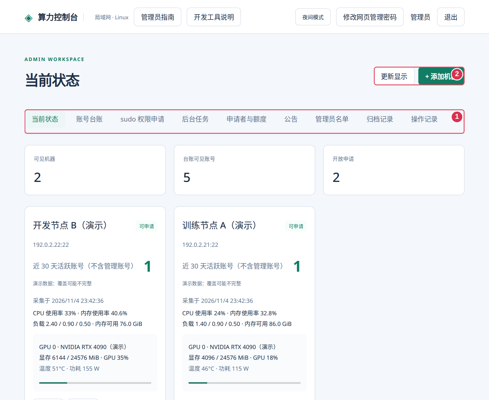
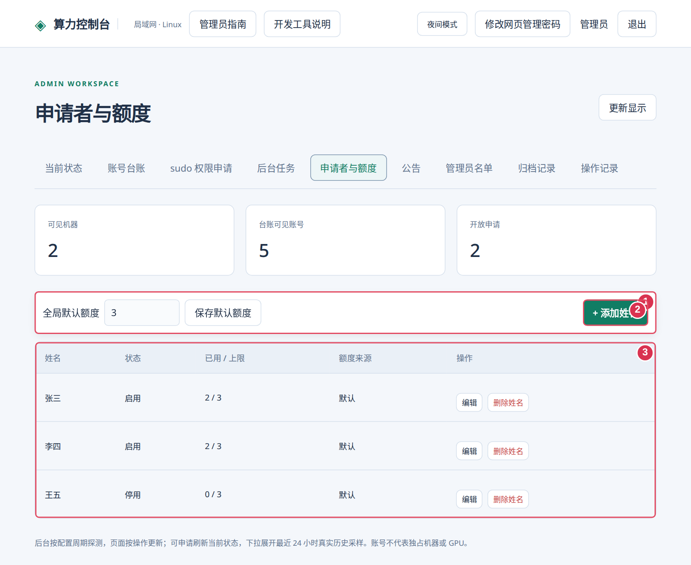
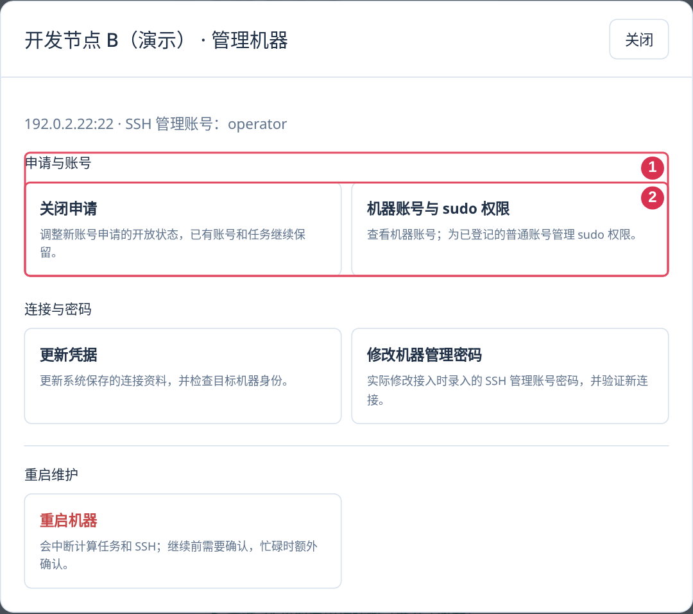
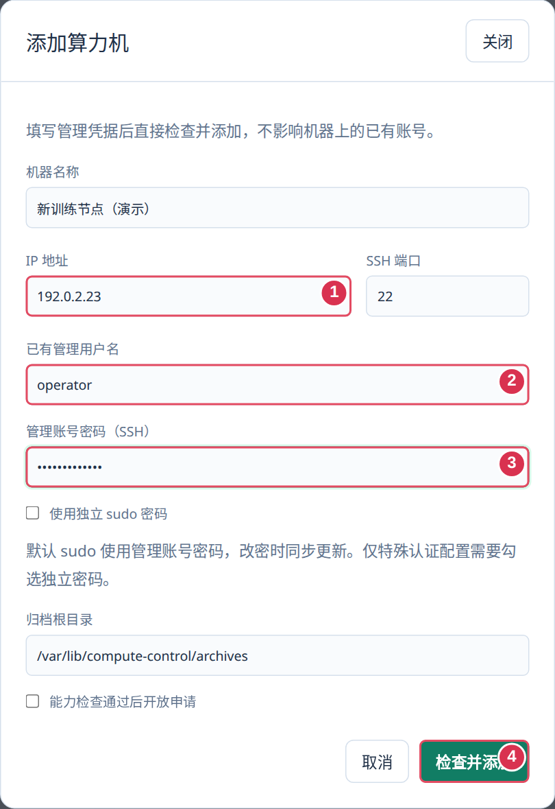
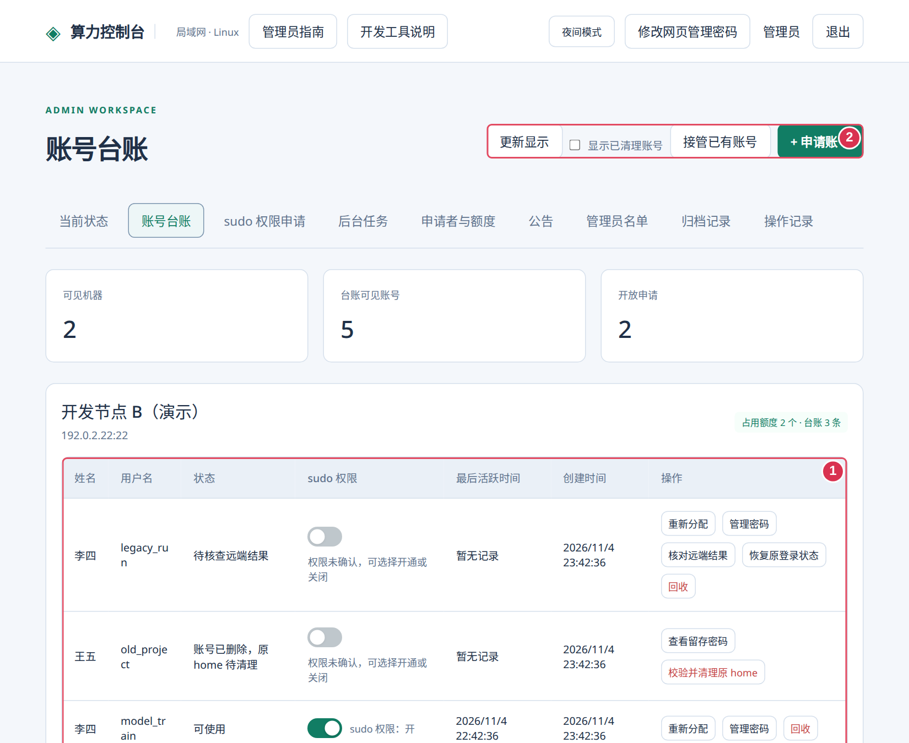
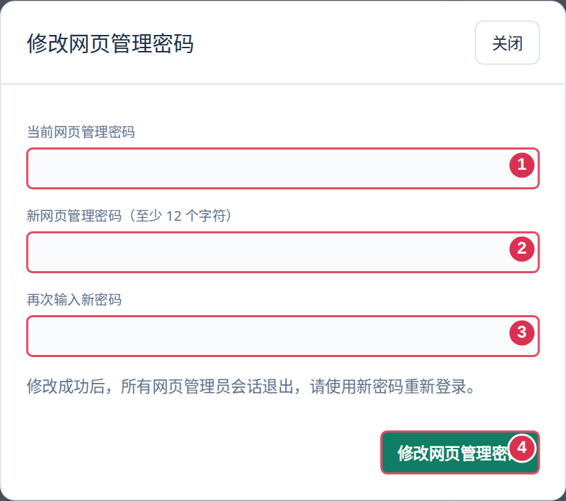
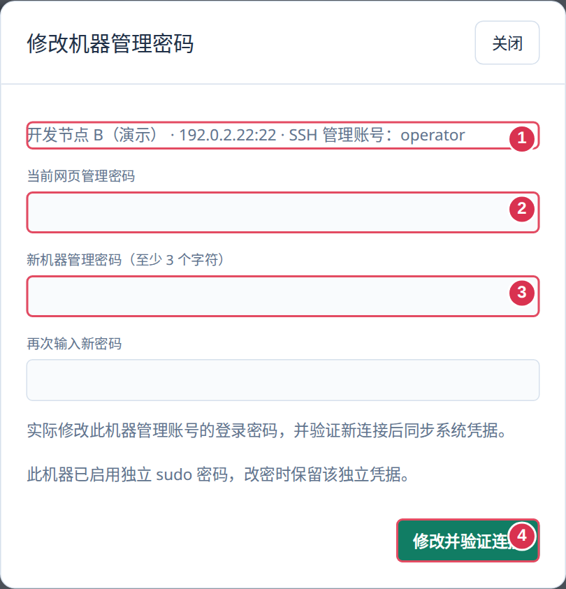
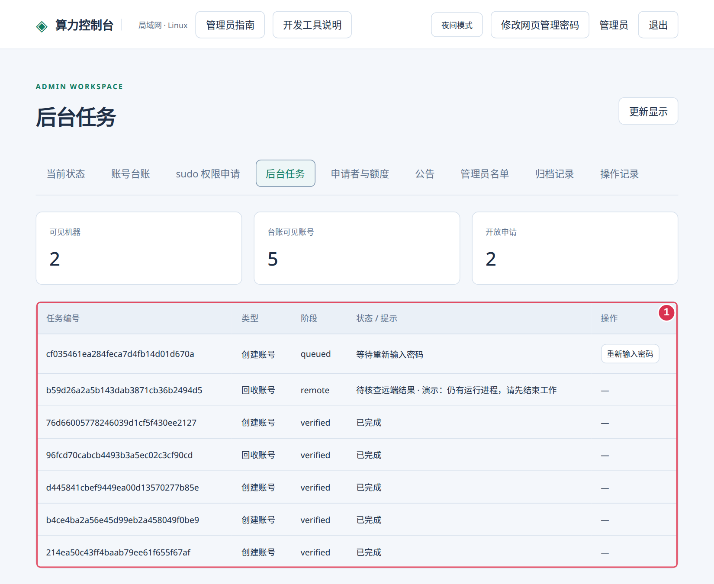

# 管理员操作指南

这是嵌入控制台的通用图文指南。截图来自独立演示数据，不包含真实部署或接入资料；机器、地址、额度和采集周期以当前配置为准。

## 快速上手

1. 使用自己部署的当前入口，在姓名窗口切换“管理员入口”，用单独保管的网页管理凭据登录。
2. 登记人员并设置额度，接入目标机器、检查能力，再按需要开放申请。
3. 在台账核对归属、sudo 权限和最后活跃时间；跟进原后台任务、回收及失败核查。
4. 维护公告和联系方式，按备份策略保管数据库、主密钥及远端归档。

网页管理员、申请者登记姓名、Linux 普通账号和机器 SSH 管理账号承担不同用途，不混用凭据或权限。

## 人员名单与额度

- “添加姓名”位于表格上方的固定操作栏。登记且启用后即可立即申请账号，不再增加一轮账号审批。
- 全局默认额度可以修改；个人留空继承，单独填写则覆盖。有效额度跨所有机器合计，同人同机可有多个账号。
- 降低额度不强制删除旧账号；停用或删除姓名会撤销进入权限，不自动回收 Linux 账号。离职需另行核对账号和数据。
- 英文字母姓名不区分大小写；重新添加已删除的同名人员恢复原身份关联，同名不同人应使用可区分名称。
- 姓名入口是可信环境中的身份声明，不是强身份认证。联系人名单只展示联系方式，不创建网页管理账号。

## 添加机器与管理机器

1. “当前状态 → 添加机器”，填写名称、当前地址、SSH 端口、已有管理凭据及独立归档目录。
2. 检查本地用户、home、SSH/sudo 和归档工具。首次记录主机密钥，后续身份变化会停止连接，更新凭据不绕过指纹。
3. 用专用测试账号验收创建、登录及回收，再开放申请。接入不自动接管旧账号、不改旧密码，也不停止进程。
4. 每台卡片点“管理机器”，集中查看申请开关、机器账号与 sudo 权限、更新凭据、管理账号改密及重启。

默认 sudo 与管理账号密码同步，只填一份密码。特殊配置勾选“使用独立 sudo 密码”后再填写第二项；免密时可留空。更新凭据时会保留已选模式，也可明确调整并验证保存。

“关闭申请”只阻止新申请，不停止已有工作。监控按配置周期采集；要新数据先“申请刷新”，完成后“更新显示”。历史折线只画有效采样，过期不代表空闲。系统开发工具检测不自动安装。

## 账号台账、接管与 sudo 权限

| 操作 | 边界 |
| --- | --- |
| 接管已有账号 | 先确认历史普通账号归属，只记录关联和证据，不改密码或进程 |
| 重新分配 | 保留账号与数据、调整归属和额度；接收人须启用且额度足够，原密码不改变 |
| sudo 滑动开关 | 确认后等待远端核验，未知不当作关闭；root、系统和机器管理账号受保护 |
| sudo 权限申请 | 可安排人工协助安装、授权 sudo 或拒绝并回复；安排不等于完成 |
| 最后活跃时间 | 最近一次可观测成功登录；无记录保持未知，不代表从未使用或进程结束 |
| 清理台账 | 须已回收、原 home 已清理且无未完成任务，只隐藏当前身份的列表，可恢复 |

历史账号先显式接管再管 sudo。关闭 sudo 不结束已有 root 进程，额外 sudoers 规则需人工核查，用户可能需重新登录。账号已分配给别人时不批准旧持有人的权限申请。

## 三类密码与离职交接

- 网页密码：顶部“修改网页管理密码”，验证当前密码并两次填写新密码。成功后所有管理员会话退出，用新密码重新登录，申请者会话保留。
- 机器管理密码：“管理机器 → 修改机器管理密码”，核对接入时录入的 SSH 管理账号，验证当前网页密码后实际改密；新 SSH/sudo 连接通过才同步系统凭据。
- 普通账号密码：台账“管理密码”可仅记录已知密码或提交实际重设任务。仅记录不验证也不修改远端，重设不结束已有进程。

未勾选独立 sudo 时，改密会同步更新 SSH/sudo 两项连接凭据；已勾选时保留独立 sudo 凭据，即使两项当前恰好相同也按该选择处理。“更新凭据”仅检查并保存已经另行修改的连接资料，与实际改密不同。

结果不明时使用“核查管理密码变更”，保留加密候选，不重复改密；有未完成平台任务时先处理原任务。人员停用或移出后才可显式查看其留存的普通账号密码，查看有审计；未保存的旧密码无法还原。

离职先确认人员与数据、停用姓名，再按授权分配或回收。分配不改密码，必要时另行重设；登录凭据应单独保管。

## 回收、归档与失败核查

1. 联系使用人结束目标账号的进程、会话与调度任务，不绕过活动工作保护。
2. 完整归档并校验 home 后删除账号，再核对归档与原 home，执行“校验并清理原 home”。内容变化会阻止清理。
3. 归档失败时保留账号和数据，检查目录、容量及原任务；结果不明先“核对远端结果”，确认原操作停止后再决定继续或恢复原登录。
4. 归档位置看该机配置和实际记录；恢复前隔离验证，不覆盖正在使用的 home，删除归档需明确确认。

主目录外数据及符号链接的外部目标不自动归档。归档、台账和审计保留关联，同机归档不代替独立备份。不要直接改库消除失败状态或释放额度。

## 公告、联系方式与备注

公告可维护历史和置顶项；置顶在成功姓名登录后弹出，关闭后切页不重复。管理员名单只展示当前联系方式，提醒申请人提交后主动联系，平台不自动发通知。

机器备注对可见该机的人共享，保留作者与时间。每人可删除自己的备注，网页管理员可删除任意备注；删除需确认，未发布草稿保留。备注不放密码、接入密钥或私人信息。

## 初始化与部署、故障维护

Web 负责网页，worker 负责后台任务和监控。网页不可达先确认当前入口和网络，再按实际部署方式检查 Web；等待密码或采样不更新时检查 worker、目标 SSH/sudo 和原任务。服务名、配置及路径以自己的安装资料为准。

忘记网页管理密码时，由维护人在实际部署环境运行 `compute-control --config <配置文件路径> reset-admin`，按提示隐藏输入新密码。数据库备份必须匹配主密钥，并先在隔离目录验证完整性和可解密。

重启 worker 前核对执行中的任务。整机重启位于“管理机器 → 重启机器”，会中断全部任务和 SSH，忙碌时需额外确认。结果不明不自动重试，恢复后核查启动状态再决定是否开放申请。

每个安装需要验收自己的目标发行版、账号创建、SSH 登录、归档回收与恢复。具体连接、部署资料和内部 PDF 另行保管，不随本通用图文指南提供。
