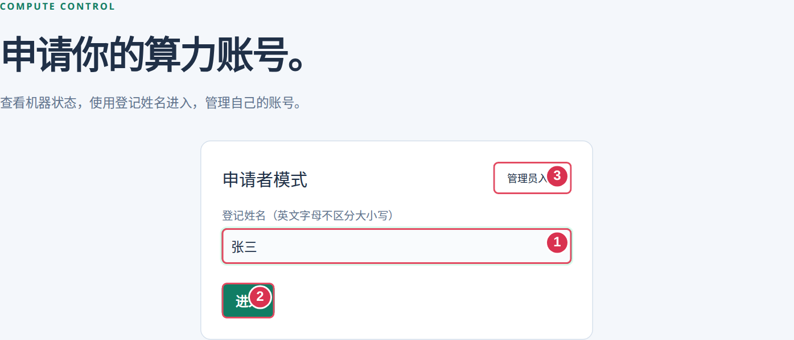
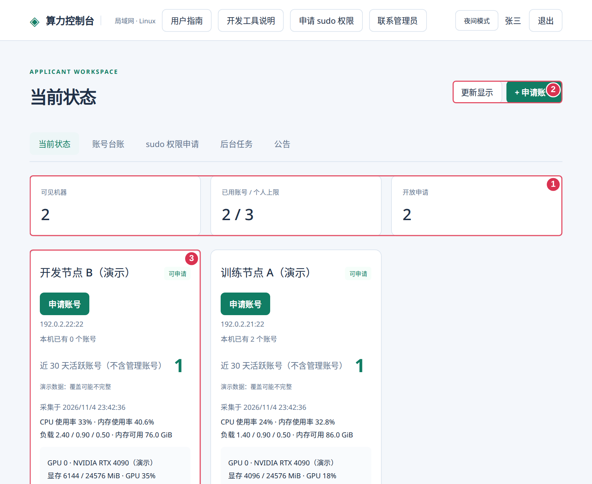
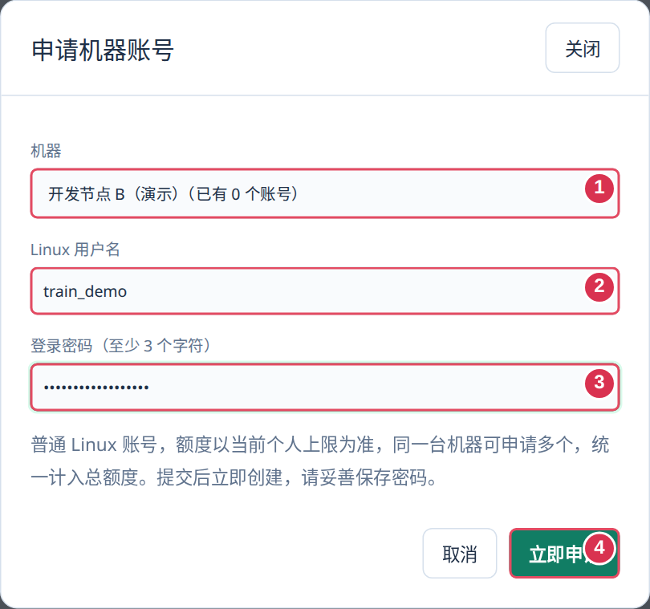
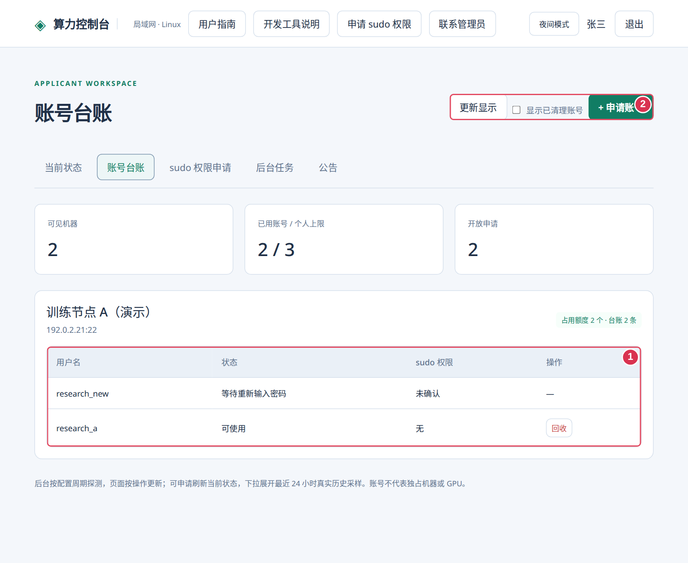
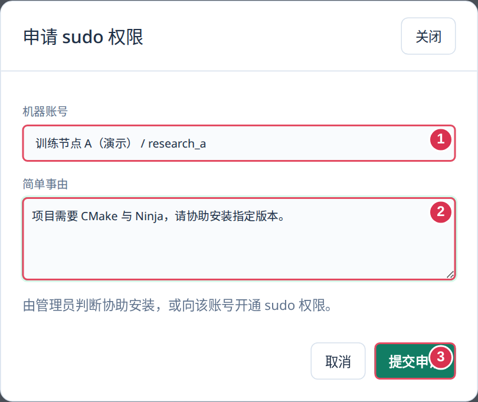
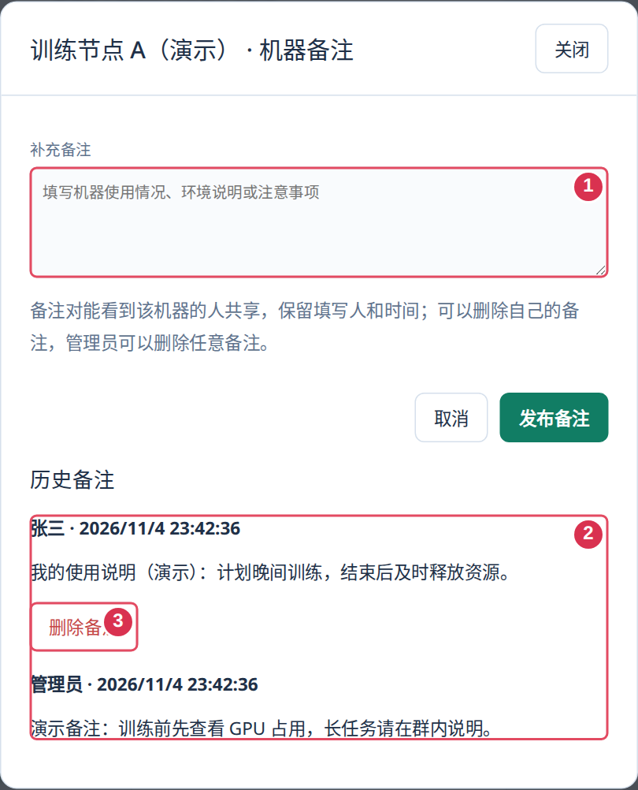

# 申请者使用指南

这是嵌入控制台的通用图文指南。截图中的姓名、机器、地址、额度及数值均为演示，实际信息以当前系统和维护人提供的资料为准。

## 快速上手

1. 打开维护人提供的入口，输入自己的登记姓名。姓名不在名单或已停用时，使用提示中的联系方式联系管理员。
2. 查看“已用账号 / 个人上限”和机器状态，选择目标机器申请账号。
3. 在原后台任务等待“已完成”，台账显示“可使用”后，用自己的 Linux 账号连接。
4. 所有申请提交后主动联系管理员；平台不会自动发送通知。



登记姓名用于进入网页，Linux 用户名和机器密码用于 SSH，二者不同。英文字母姓名不区分大小写；请只使用自己的身份，勿进入或操作他人名下账号。

## 选机器、看负载与更新显示



- 机器列表展示开放申请的机器，以及你已有账号所在的机器。账号不代表独占 GPU 或其他资源。
- 后台按配置周期采集，关闭网页也继续；页面不持续自动更新。需要新数据时先点“申请刷新”，完成后再“更新显示”。
- 历史折线可下拉展开并比较多台机器；缺失数据不会补零，过期和未知不等于空闲。
- 历史活跃人数不等于当前在线人数；“无登记账号”不代表可以接管或删除。

## 申请账号与 SSH 连接



1. 从机器卡片或账号台账打开“申请账号”，再次核对目标机器。
2. 按表单规则设置用户名与机器密码，提交后等待原任务结果，不重复申请。
3. 使用当前可达的机器地址、SSH 端口和自己的 Linux 用户名连接；不要把控制台入口当作目标机器地址。

```sh
ssh -p <SSH端口> <自己的Linux用户名>@<当前可达的机器地址>
```

终端输入密码通常没有字符回显。用户名已存在时换名字，不能覆盖旧账号；机器密码自行保存，申请者页面不回显。出现“等待重新输入密码”时，在原任务继续输入。

## 额度与账号台账



- 个人上限由当前全局默认额度或个人设置决定，跨机器合计；同一台机器可以有多个账号，统一计入总额度。
- 创建中、回收中或结果不明的账号可能仍占额度；先处理原任务，确有需要再联系管理员调整。
- 台账仅展示自己的账号，按机器分组，显示用户名、状态、sudo 权限及可用操作。
- 完成回收、原 home 清理且无未完成任务后，才可“清理台账”。这只隐藏当前身份的显示，勾选“显示已清理账号”可恢复，不删除归档或审计。

## sudo 权限申请与开发工具



1. 顶栏点“申请 sudo 权限”，写明工具、所需版本、用途及项目环境，提交后主动联系管理员。
2. 在“sudo 权限申请”查看回复。协助安装是人工安排；授权以远端任务核验后的状态为准，不把提交成功当作已经生效。
3. 同一账号有待处理申请时勿重复提交。需要补充或被拒绝时按回复处理。

共享驱动、CUDA 和系统工具由管理员维护；个人工具放 home，项目依赖放项目环境。机器卡片的“系统开发工具”只做检测，不自动安装。驱动显示的 CUDA 兼容版本不等于已安装 Toolkit。

## 公告、联系管理员与机器备注



- 顶栏可查看公告、当前联系人和开发工具说明，也可切换主题。置顶公告在成功姓名登录后弹出，关闭后切页不重复弹。
- 备注对能看到该机的人共享，保留作者和时间。每人可删自己的备注，网页管理员可删任意备注；删除需确认，未发布草稿保留。
- 只写工作安排和环境说明，不写密码、接入密钥或私人信息。
- 联系时提供登记姓名、机器、Linux 用户名、任务编号、错误全文及时间；密码单独保管。

## 回收与失败处理

1. 保存工作，结束自己的计算任务、会话和后台进程，先保存主目录外的数据。
2. 在账号台账核对机器、用户名及主目录，再确认“回收”。
3. 系统完整归档并校验 home 后才删除账号；成功删除后释放额度，原 home 由管理员进一步确认清理。
4. 有活动任务、归档失败或结果不明时先联系管理员，不反复提交；关闭网页不会取消原任务。

主目录外数据、符号链接的外部目标不在自动归档范围。失败时账号和数据会保留，但登录可能已停用，不能假定已恢复。需要归档中的数据时联系管理员。

| 问题 | 下一步 |
| --- | --- |
| 网页或 SSH 不通 | 核对当前入口、目标机器、可达地址及端口 |
| 姓名未登记或停用 | 联系管理员确认自己的登记状态 |
| 额度不足或机器未开放 | 查看当前额度、原任务及机器状态 |
| 忘记机器密码 | 联系管理员处理，不新建同名账号覆盖 |
| 任务待核查 | 保存原编号和提示，由管理员核对远端结果 |
